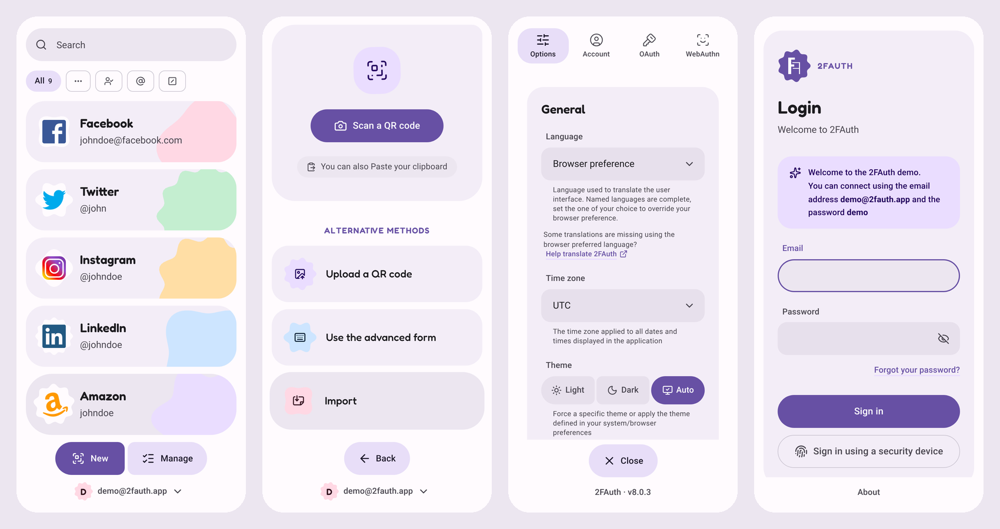
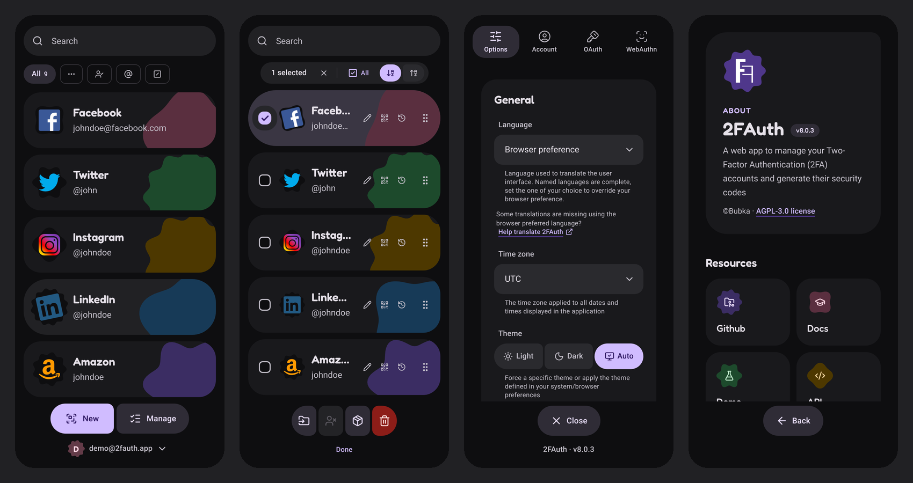
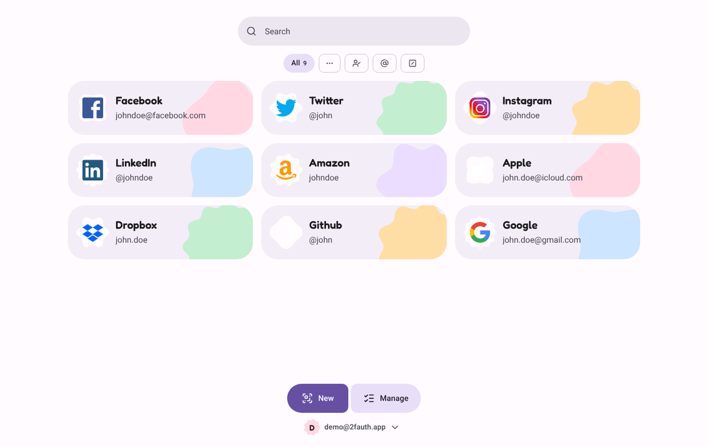
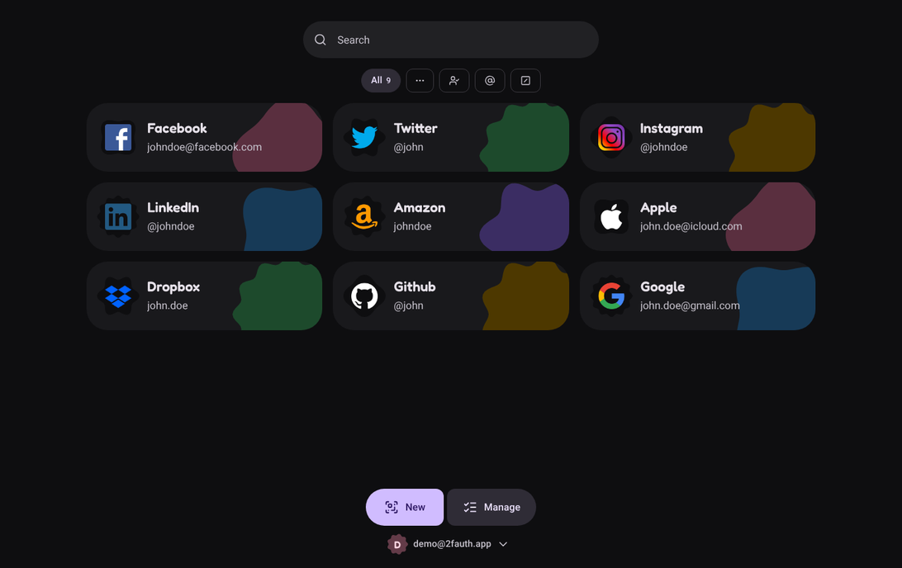

# 2FAuth


A self-hosted web app to manage your Two-Factor Authentication (2FA) accounts and generate their security codes — now with a **Material 3 Expressive** interface, light and dark.

> This repository is a fork of [Bubka/2FAuth](https://github.com/Bubka/2FAuth). It keeps the upstream features and adds a full UI redesign plus ready-to-use Docker stacks for development and production. See [What's different in this fork](#whats-different-in-this-fork).




[**Upstream demo**](https://demo.2fauth.app/) (original design) — credentials `demo@2fauth.app` / `demo`

## Purpose

2FAuth is a web based, self-hosted alternative to One Time Passcode (OTP) generators like Google Authenticator, designed for both mobile and desktop.

It aims to ease your 2FA steps on whatever device you're using, with a clean, friendly interface:

* No wall of codes with stressful countdowns — codes are shown on demand (or always on, if you prefer)
* Your 2FA accounts live in a standalone database you can easily back up and restore
* No need to reach for your phone when you're working on a desktop computer

## Features

**Accounts & codes**
* Generate TOTP, HOTP and Steam Guard codes, with a visual countdown and an optional preview of the next code
* Add accounts by scanning a QR code with the camera, uploading a QR image, pasting from the clipboard, or with the advanced form
* Edit any account, even imported ones; show an account's QR code again at any time
* Copy a code in one tap, optionally clearing the search and logging you out afterwards
* Per-account OTP generation history

**Organisation**
* Groups, with quick group switching from the home screen
* Search, sort (A→Z / Z→A, case-sensitive option) and drag-and-drop reordering
* Bulk actions: move to a group, export, delete
* List or grid layout

**Sharing (multi-user)**
* Share an account with specific users or with everyone on the instance
* Filter views for "accounts I'm sharing" and "accounts shared with me"
* Transfer ownership of an account to another user

**Import & export**
* Import from 2FAuth (JSON), Google Authenticator (QR code), Aegis (JSON, plain text) and 2FAS (JSON) — see the [import guide](https://docs.2fauth.app/getting-started/usage/import/)
* Export selected accounts as 2FAuth JSON or `otpauth://` URIs

**Administration**
* Admin panel: app setup, authentication policy, user management and access logs
* Open, domain-restricted, SSO-only or closed registration
* Personal access tokens for the REST API

**Interface**
* Material 3 Expressive design in light, dark or automatic theme
* Works on phones and desktops
* Localised through [Crowdin](https://crowdin.com/project/2fauth)

## Design

The whole front end was redesigned following **Material 3 Expressive** and built with **Tailwind CSS v4**.

* **Shape that reacts** — buttons, icon buttons, chips, menus and cards are round at rest and squash or round out on hover and press, then spring back.
* **Expressive shapes** — account icons, avatars and feature tiles sit in cookie, clover, flower and burst shapes that spin playfully on hover. The loading indicator is a shape that morphs as it rotates.
* **Big, friendly account cards** — large shaped logos, bold service names and a coloured decorative shape per account. Selected cards morph into a full pill in management mode.
* **Rounded filled inputs** — text fields turn into a pill with a primary ring on focus; on/off options are switches whose thumb grows and shows a check; choice options are connected button groups.
* **Connected bottom bar** — the main actions form one joined button group that pops in and stretches when pressed.
* **Flat, solid colour** — no gradients, no translucent colours, no drop shadows; surfaces are separated by tone. Dark mode uses near-black surfaces.
* **Clear alerts** — success, warning, error and info messages use solid tonal containers with an outline, readable in both themes.
* **Type** — Fredoka for headings, Roboto for text, Roboto Mono for codes.

| Light | Dark |
| --- | --- |
|  |  |

All design tokens (colours, shapes, motion) and component classes live in [`resources/css/app.css`](resources/css/app.css). The colour palette is exposed as CSS variables (`--md-*`) and swapped under the `.dark` class, so a custom palette only needs new token values.

## Security

### Multi-user app

You have to create a user account and sign in to use the app. You can allow public registration, limit registration by email domain, restrict it to SSO, or turn it off entirely.

### Modern authentication

Sign in with a security key such as a YubiKey or a Titan key (WebAuthn) and, if you want, disable the traditional login form.

### Data encryption

Sensitive data stored in the database can be encrypted to protect it against a database compromise. Encryption is optional and off by default. Back up the `APP_KEY` value of your `.env` file (or the whole file) when encryption is on.

### Auto logout

2FAuth logs you out after a period of inactivity to avoid long-lived sessions. Auto logout can be turned off, or triggered when a code is copied.

### RFC compliance

OTPs are generated according to RFC 4226 (HOTP) and RFC 6238 (TOTP) using the [Spomky-Labs/OTPHP](https://github.com/Spomky-Labs/otphp) library.

## Requirements

* PHP ^8.4 (the Docker images ship PHP 8.5)
* See [Laravel server requirements](https://laravel.com/docs/installation#server-requirements)
* Any database [supported by Laravel](https://laravel.com/docs/database) (MariaDB/MySQL, PostgreSQL, SQLite)
* Node.js 22+ to build the front end

## Running with Docker

Two stacks are included. Both run nginx, PHP-FPM and the Laravel scheduler in a single container under supervisord, as the non-root `www-data` user. Queued jobs run synchronously (`QUEUE_CONNECTION=sync`), so no queue worker or `jobs` table is needed.

### Development — `docker-dev/`

The project folder is bind-mounted, so code changes are live.

```bash
cp docker-dev/.env.example docker-dev/.env   # UID/GID, ports
cp .env.example .env                         # app settings (DB_*, APP_URL …)
docker compose -f docker-dev/docker-compose.yml up -d --build
docker exec -it 2fauth composer install
docker exec -it 2fauth php artisan 2fauth:install   # generates APP_KEY, migrates, Passport keys
npm install && npm run dev                          # front end with hot reload
```

The app is served on <http://localhost:8009>. `APP_URL` in `.env` must match the URL you open, otherwise WebAuthn refuses to work.

### Production — `docker-prod/`

A multi-stage build compiles the front end (Node 22) and installs production Composer dependencies; nothing from your `.env` is baked into the image.

```bash
cp docker-prod/.env.example docker-prod/.env   # image tag, port, limits
cp .env.example .env                           # application settings
# first start (and after upgrades): RUN_MIGRATIONS=true in docker-prod/.env
docker compose -f docker-prod/docker-compose.yml up -d --build
```

* Published on `127.0.0.1:8010` by default — put your reverse proxy in front of it (it can reach the container as `http://2fauth:8080` on the shared `proxy` network).
* Hardened container: read-only root filesystem, all Linux capabilities dropped, `no-new-privileges`, CPU/memory/PID limits, no Docker socket.
* `storage/` is kept in a named volume; SQLite (`DB_CONNECTION=sqlite`) can live there too.

Upstream installation guides (bare metal, official image, Heroku) are still valid: [self-hosted server](https://docs.2fauth.app/getting-started/installation/self-hosted-server/) · [Docker CLI](https://docs.2fauth.app/getting-started/installation/docker/docker-cli/) · [Docker Compose](https://docs.2fauth.app/getting-started/installation/docker/docker-compose/) · [Heroku](https://docs.2fauth.app/getting-started/installation/heroku/)

## Front-end development

* Vue 3 SPA (Pinia, vue-router, vue-i18n) built with Vite 7 and Tailwind CSS v4 (`@tailwindcss/vite`).
* The UI components formerly pulled from the separate `2FAuth-Components` package are vendored under [`resources/js/packages/`](resources/js/packages) (`ui`, `formcontrols`, `stores`) and imported through the `@2fauth/*` aliases in `vite.config.js`.
* Main component classes: `md-btn` (+ `filled`, `tonal`, `outlined`, `text`, `danger`…), `md-icon-btn`, `md-input`, `md-select`, `md-textarea`, `md-search`, `md-switch`, `md-checkbox`, `md-segmented`, `md-chip`, `md-card`, `md-list`, `md-menu`, `md-callout`, `md-tab`, `md-dock`, `md-shape-*`, `md-tone-*`, `md-loader`.

```bash
npm install
npm run dev      # Vite dev server
npm run build    # production build into public/build
```

## Upgrading

* [Upgrade guide](https://docs.2fauth.app/getting-started/upgrade/) (upstream)
* With `docker-prod`, rebuild the image and start once with `RUN_MIGRATIONS=true`.

## What's different in this fork

* Complete Material 3 Expressive redesign of every screen, with light and dark themes
* Bulma/Sass replaced by Tailwind CSS v4; `2FAuth-Components` vendored into the repository
* `docker-dev` and `docker-prod` stacks (PHP 8.5, nginx, supervisord, hardened production container)
* Queue set to `sync` in the Docker stacks so no queue worker is required

Everything else — features, API, data format — follows upstream, so data can move between this fork and the original app.

## Contributing

* Report bugs or suggest improvements for this fork through its issue tracker.
* For core features and translations, contribute upstream: [Bubka/2FAuth issues](https://github.com/Bubka/2FAuth/issues) · [Crowdin](https://crowdin.com/project/2fauth)

## Credits

* [2FAuth](https://github.com/Bubka/2FAuth) by Bubka — the original application
* [Material 3 Expressive](https://m3.material.io/) design language by Google
* [Lucide](https://lucide.dev/) icons, [Fredoka](https://fonts.google.com/specimen/Fredoka) and [Roboto](https://fonts.google.com/specimen/Roboto) fonts

## License

[AGPL-3.0](https://www.gnu.org/licenses/agpl-3.0.html)
